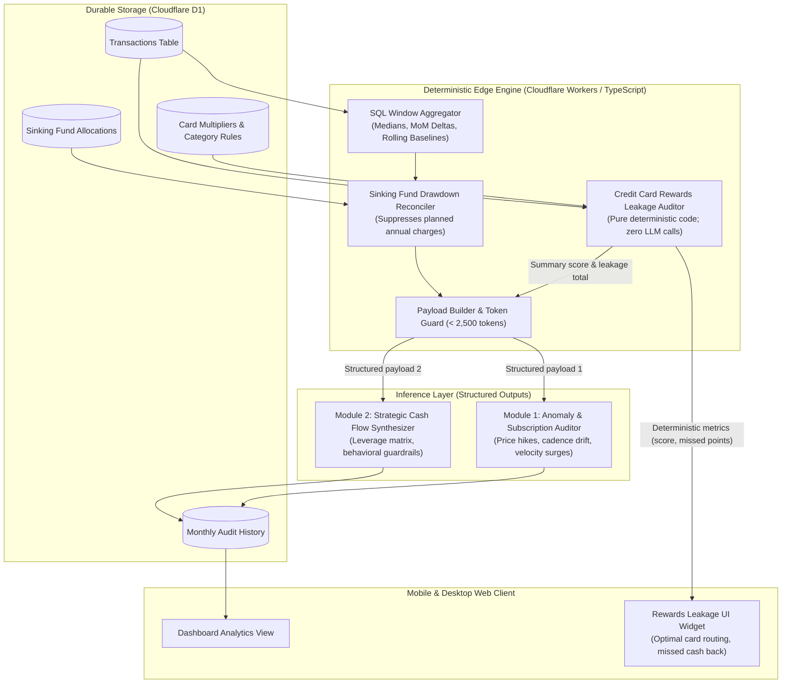

# SnapTally Modular Analytics and Intelligence Architecture

This document specifies the architecture, data flow, statistical thresholds, deterministic calculation contracts, and structured LLM inference modules powering SnapTally's monthly analytics engine.

---

## 1. Architectural Philosophy and System Boundaries

SnapTally enforces a strict separation between **deterministic computation** and **semantic reasoning**:

1. **Arithmetic and Rule Validation Belong in Code**:
   - Tabular sums, averages, medians, percentage allocations, and multiplier reward calculations are executed deterministically on Cloudflare D1 (SQLite) and TypeScript edge functions.
   - Language models are never tasked with summing transactions, calculating reward rates, or computing percentages.
2. **Semantic Synthesis and Habit Evaluation Belong in LLMs**:
   - Models are deployed exclusively for pattern recognition, psychological trade-off evaluation, and strategic lifestyle recommendations.
   - Prompts receive pre-aggregated, sanitized JSON payloads containing statistical summaries and deterministic flags rather than raw transaction logs.
3. **Dual Execution Model**:
   - **On-Demand (Interactive)**: Triggered directly from the SnapTally mobile and desktop dashboard via `POST /api/analysis/audit`. Cached results render instantly; re-runs evaluate the active month against trailing baselines.
   - **Scheduled (Automated Background)**: Triggered on a monthly schedule (e.g. 1st of every month at 08:00 UTC via Cloudflare Cron Triggers). The background runner pre-computes metrics, executes model inference, persists audit records to D1, and dispatches a monthly executive digest via configured webhooks.



---

## 2. Solution Space Comparison

| Strategy | Upstream Compute | Hallucination Risk | Token Cost and Latency | Operational Profile |
| :--- | :--- | :--- | :--- | :--- |
| **1. Monolithic Raw Dump**<br>(Raw CSV/rows fed into single prompt for categorization, math, and advice) | Minimal | Critical (LLMs hallucinate tabular totals, omit small transactions, drop schema bounds) | High ($O(N)$ tokens; high latency) | Unacceptable for financial tracking. |
| **2. Single-Pass Aggregate Synthesizer**<br>(Full monthly rollup into one prompt for all domains) | Moderate | Moderate | Low | Suffers from "loss in the middle"; model prioritizes obvious categories (dining) while ignoring recurring drift and card nuances. |
| **3. Decoupled Modular Analyzers (Adopted)**<br>(Deterministic pre-aggregation; isolated single-responsibility prompts; zero-LLM rewards math) | Moderate to High (SQL window functions compute metrics) | Near Zero | Minimal (parallelizable, compact payloads < 2,500 tokens) | Strictly deterministic, testable, reproducible, and resilient against API outages. |

---

## 3. Deterministic Pre-Computation Engine

### 3.1 Dual-Gate Velocity Thresholds
Traditional anomaly detection relying on parametric $z$-scores ($\mu \pm 2\sigma$) fails on consumer personal finance data due to small sample sizes ($N \le 3$ to $12$ months) and heavy skew. A single irregular month distorts standard deviation, hiding subsequent surges.

SnapTally replaces $z$-scores with **dual-gate non-parametric thresholds**:
1. **Relative Gate**: Active month category spend exceeds $1.30 \times$ trailing 3-month median spend.
2. **Absolute Dollar Gate**: Active month category spend minus trailing 3-month median spend exceeds $\$75.00$.

Both gates must pass simultaneously before an anomaly flag is generated. This guarantees that small budget shifts (e.g. $\$12 \to \$18$ for cloud storage) never trigger velocity alarms, while genuine surges (e.g. $\$400 \to \$650$ for dining) are surfaced immediately.

### 3.2 Sinking Fund Drawdown Reconciliation
A common failure mode in personal budgeting systems is flagging large planned annual expenses (car insurance premiums, annual software subscriptions, holiday travel) as "lifestyle creep."

Before packaging anomaly payloads, the pre-computation engine checks transactions against the user's sinking fund allocations:
- If a recurring charge matches a merchant tagged under `Savings -> Annual Subscriptions` or `Savings -> Annual Bills`, it is labeled as a planned drawdown.
- Planned drawdowns are reconciled against the accumulated sinking fund balance.
- Reconciled drawdowns are excluded from the anomaly alert payload passed to the language model.

---

## 4. Module 1: Deterministic Credit Card Rewards Leakage Auditor (Zero LLM)

### 4.1 Specification and Rationale
Credit card rewards optimization is an exact mathematical problem based on deterministic category multipliers. Outsourcing this calculation to an LLM produces rounding errors, hallucinated multiplier values, and non-deterministic scoring.

In SnapTally, rewards leakage is computed **entirely in deterministic TypeScript and SQL**, bypassing the LLM completely.

### 4.2 Mathematical Contract
For each transaction $t$ with net spend $S_t$, category $C_t$, and card used $K_{\text{used}}$:

1. **Achieved Multiplier**: $M_{\text{actual}} = \text{lookup}(K_{\text{used}}, C_t)$
2. **Optimal Card and Multiplier**:
   $$K_{\text{optimal}} = \arg\max_{k \in \text{Wallet}} \text{lookup}(k, C_t)$$
   $$M_{\text{optimal}} = \max_{k \in \text{Wallet}} \text{lookup}(k, C_t)$$
3. **Points Foregone**:
   $$P_{\text{lost}} = \sum_{t} S_t \times \max(0, M_{\text{optimal}} - M_{\text{actual}})$$
4. **Estimated Cash Value Lost**:
   $$V_{\text{lost}} = P_{\text{lost}} \times \text{valuation}(C_t)$$
   *(where valuation defaults to 1.0 cent per point for cash back or conservative transferable points valuation).*
5. **Wallet Efficiency Score**:
   $$\text{Efficiency} = \left( \frac{\sum_t S_t \times M_{\text{actual}}}{\sum_t S_t \times M_{\text{optimal}}} \right) \times 100$$

### 4.3 UI Presentation Contract
The output of this calculation renders directly in the SnapTally UI as a dedicated card without latency or external API cost:
- **Efficiency Metric**: Clean visual percentage (e.g., 94% optimal).
- **Leakage Summary**: Total missed points and cash equivalent (e.g., 1,420 points / $14.20 foregone).
- **Misrouted Categories**: Tabular breakdown of the top routing errors with clear corrective rules (e.g., "Use American Express Gold for Groceries rather than 2% Visa").

---

## 5. Module 2: Anomaly and Subscription Creep Auditor (LLM-Assisted)

### 5.1 Objective
Audits recurring transactions and un-reconciled category velocity surges to detect silent price hikes, irregular frequency shifts, and unexpected lifestyle drift.

### 5.2 System Prompt

```text
You are an expert personal finance forensic auditor. Your task is to evaluate monthly recurring charges and category velocity anomalies.

Rules:
1. Ground every statement strictly in the provided data. Never invent figures or merchants.
2. Flag stealth price increases where current billing exceeds previous billing.
3. Identify zombie subscriptions where cadence or merchant activity suggests forgotten recurring commitments.
4. Distinguish between expected episodic spend and true lifestyle creep.
5. Provide actionable, high-leverage steps to eliminate waste.
6. Output valid JSON matching the schema with zero preamble and zero markdown wrapping.
```

### 5.3 Input Payload Contract (JSON)

```json
{
  "billing_period": "2026-10",
  "recurring_merchants": [
    {
      "merchant": "Streaming Service A",
      "current_amount": 22.99,
      "previous_amount": 19.99,
      "cadence": "monthly",
      "flag": "amount_increased"
    },
    {
      "merchant": "Cloud Storage",
      "current_amount": 9.99,
      "previous_amount": 9.99,
      "cadence": "monthly",
      "flag": "stable"
    }
  ],
  "category_velocity_outliers": [
    {
      "category": "Dining & Takeout",
      "current_total": 840.00,
      "trailing_3mo_median": 510.00,
      "relative_ratio": 1.65,
      "dollar_delta": 330.00,
      "top_contributors": ["DoorDash ($210.00)", "Local Bistro ($185.00)"]
    }
  ],
  "sinking_fund_status": {
    "active_drawdowns_count": 2,
    "annual_charges_reconciled": true
  }
}
```

### 5.4 Output Schema Contract (JSON Schema)

```json
{
  "type": "object",
  "properties": {
    "subscription_alerts": {
      "type": "array",
      "items": {
        "merchant": { "type": "string" },
        "severity": { "type": "string", "enum": ["HIGH", "MEDIUM", "LOW"] },
        "reason": { "type": "string" },
        "recommended_action": { "type": "string" }
      }
    },
    "velocity_anomalies": {
      "type": "array",
      "items": {
        "category": { "type": "string" },
        "root_cause": { "type": "string" },
        "is_one_off": { "type": "boolean" },
        "actionable_leverage_point": { "type": "string" }
      }
    }
  },
  "required": ["subscription_alerts", "velocity_anomalies"],
  "additionalProperties": false
}
```

---

## 6. Module 3: Strategic Cash Flow and Habit Synthesizer (LLM-Assisted)

### 6.1 Objective
Synthesizes high-level capital allocations against Conscious Spending Plan benchmarks (Fixed Costs, Investments, Savings Goals, Guilt-Free Spending) to provide executive-level behavioral guardrails and structural interventions.

### 6.2 System Prompt

```text
You are an executive personal balance sheet advisor. Your task is to analyze monthly income allocations and discretionary spending clusters.

Rules:
1. Ignore trivial cutbacks (< $30/month) unless they reflect systemic recurring drag.
2. Focus on structural expenses, contract negotiations, frequency caps, and automated behavioral friction.
3. Every recommendation must follow the Leverage Matrix: specify implementation friction (LOW, MEDIUM, HIGH), monthly run-rate savings, and psychological sustainability (integer 1 to 5).
4. Strictly avoid condescending tropes (e.g. cutting out coffee or dining out entirely). Emphasize conscious substitution and high-leverage friction.
5. Output valid JSON matching the schema with zero preamble and zero markdown wrapping.
```

### 6.3 Input Payload Contract (JSON)

```json
{
  "period": "2026-10",
  "macro_metrics": {
    "net_income": 7800.00,
    "fixed_costs_ratio": 0.52,
    "investments_ratio": 0.18,
    "savings_goals_ratio": 0.08,
    "guilt_free_ratio": 0.22,
    "wallet_efficiency_score": 93.5
  },
  "discretionary_clusters": [
    {
      "cluster": "Food Delivery Platforms",
      "monthly_spend": 385.00,
      "order_count": 12,
      "avg_ticket": 32.08
    },
    {
      "cluster": "Rideshare Apps",
      "monthly_spend": 240.00,
      "order_count": 8,
      "surge_percentage": 42.0
    }
  ]
}
```

### 6.4 Output Schema Contract (JSON Schema)

```json
{
  "type": "object",
  "properties": {
    "capital_allocation_verdict": {
      "type": "string",
      "enum": ["OPTIMAL", "SLIGHT_DRIFT", "STRUCTURAL_DRAG", "CRITICAL_OVERSPEND"]
    },
    "high_leverage_interventions": {
      "type": "array",
      "items": {
        "domain": { "type": "string" },
        "friction": { "type": "string", "enum": ["LOW", "MEDIUM", "HIGH"] },
        "monthly_run_rate_savings": { "type": "number" },
        "specific_tactic": { "type": "string" },
        "behavioral_guardrail": { "type": "string" }
      }
    },
    "macro_observation": { "type": "string" }
  },
  "required": [
    "capital_allocation_verdict",
    "high_leverage_interventions",
    "macro_observation"
  ],
  "additionalProperties": false
}
```

---

## 7. Execution Architecture and Workflows

### 7.1 On-Demand Dashboard Trigger
```
User navigates to Dashboard -> Taps "Run Monthly Audit"
  │
  ├──> GET /api/analysis/rewards (Computes deterministic leakage in < 5ms)
  │      └──> Immediate render of Rewards Efficiency Card
  │
  └──> POST /api/analysis/audit (Triggers modular inference)
         ├──> Checks D1 cache for current month's audit
         ├──> If stale:
         │      ├──> Executes SQL window queries for trailing 90 days
         │      ├──> Compiles compact payloads (< 2,000 tokens)
         │      ├──> Parallel calls to Module 1 and Module 2
         │      └──> Persists structured results to D1 audit table
         └──> Returns unified JSON payload for Alpine.js dashboard display
```

### 7.2 Scheduled Monthly Cron Trigger
```
Cloudflare Cron Trigger fires (e.g. 0 8 1 * *)
  │
  ├──> Worker invokes runMonthlyScheduledAudit(month)
  ├──> Executes deterministic SQL aggregations
  ├──> Runs Module 1 and Module 2 inference with Structured Outputs
  ├──> Persists audit results to D1 `monthly_audits` table
  └──> Formats markdown digest and posts to configured webhook (Discord / Telegram)
```

---

## 8. Failure Modes, Edge Cases, and Mitigations

1. **Merchant Normalization Inconsistencies**:
   - Problem: Varied merchant billing strings (`AMZN Mktp US`, `Amazon.com`, `AMAZON PAY`) obscure recurring cadences.
   - Mitigation: Leverages SnapTally's canonical merchant resolution pipeline (`toAlphanumericKey` and canonical table lookup in `queries/select_distinct_merchants.sql`) to unify descriptors prior to aggregation.
2. **Context Window Expansion**:
   - Problem: High monthly transaction volume (150+ transactions) risks token bloat and context drift.
   - Mitigation: Never passes raw transaction rows. Payloads strictly contain aggregated cluster totals, count metrics, top 3 merchant items by dollar volume, and pre-computed statistical deltas.
3. **LLM Schema Non-Compliance**:
   - Problem: Free-form markdown formatting or missing JSON fields breaks dashboard parsers.
   - Mitigation: Enforces API-level **Structured Outputs** (`response_format: { type: "json_schema", json_schema: { strict: true, ... } }`).
4. **External API Outage or Network Timeout**:
   - Problem: DeepSeek or Gemini API experiences high latency (> 5000ms) or 5xx outages.
   - Mitigation: The dashboard immediately displays the deterministic metrics (CSP allocations and Credit Card Rewards Leakage). If the LLM call times out, the system generates fallback deterministic cards based directly on the raw anomaly flags without breaking the user experience.
