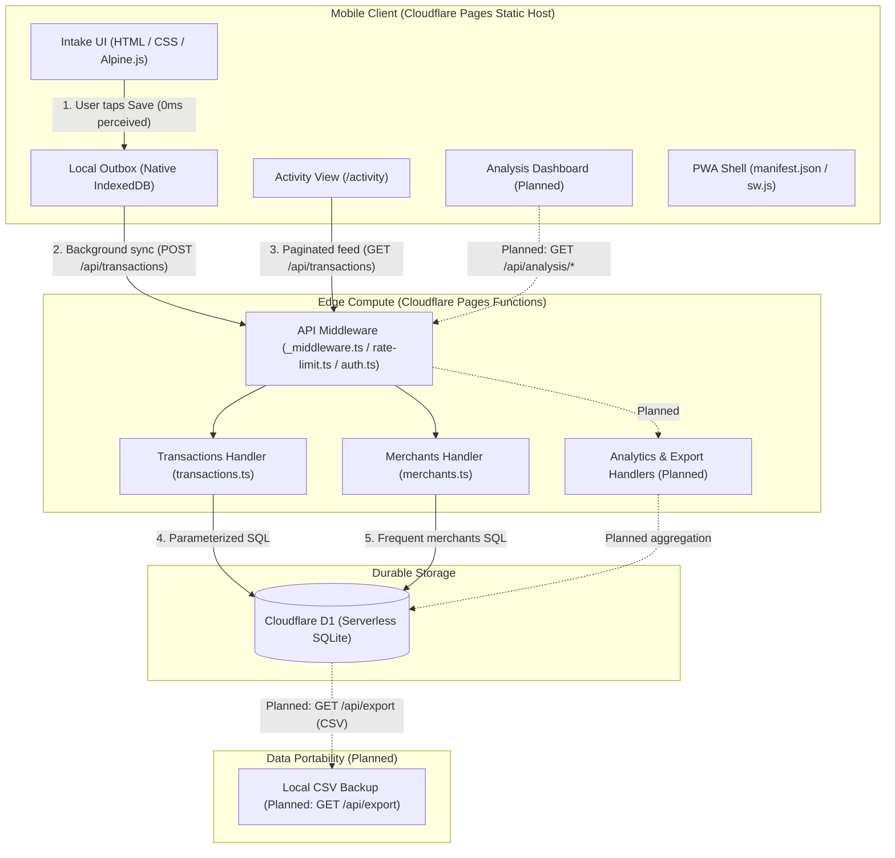

# SnapTally Architecture and Design

This document details the architectural choices, data flow, storage strategies, and operational parameters for SnapTally.

## System Overview

SnapTally provides a unified personal finance platform focused on rapid point-of-sale intake and planned Conscious Spending Plan budget analysis. The system combines an ultra-fast, fixed-viewport intake PWA with serverless edge analytics backed by Cloudflare D1.



## Core Design Principles

1. **Sub-5-Second Point of Sale Logging**: Tapping native dropdowns triggers slow platform pickers. SnapTally uses single-tap pill buttons for cards and parent categories, updating subcategories dynamically in memory.
2. **Offline-First Resilience**: Bad network reception at checkout counters or basements must not block entry. Submissions persist immediately to client storage and synchronize when the network is reachable.
3. **Zero-Maintenance Infrastructure**: Serverless edge hosting and serverless relational storage remove OS patching, VPS maintenance, and container upkeep.
4. **Intake Speed Protection with Dedicated Edge Analysis**: While SnapTally plans integrated monthly Conscious Spending Plan analysis and sinking fund tracking, the primary intake viewport remains strictly decoupled from analytical computation to guarantee a sub-5-second checkout entry experience.
5. **Clear Financial Accounting**: Methodology explicitly separates monthly discretionary cash flow from sinking fund drawdowns (e.g. travel funds) and accounts for reimbursements on a net-spend basis. See [docs/budgeting.md](budgeting.md) for full taxonomy and accounting rules.

## Client Layer

### Touch-Friendly UI

- **Responsive Viewport**: Sized to `min-h-dvh overflow-y-auto overscroll-none` with `viewport-fit=cover` to eliminate unwanted rubber-banding while ensuring full vertical accessibility across short screens and landscape orientations without disabling pinch zoom.
- **Built-in On-Screen Keypad**: A custom 3x4 numeric keypad with ATM-style cents shifting (`$0.00` formatted amount display) ensures the native mobile virtual keyboard is never triggered for amount entry.
- **Pill Chips**: Cards, merchants, and categories render as touch-friendly tap targets styled for thumb reachability (minimum 44x44px touch targets).
- **Dynamic Dependent Chips**: Categories and subcategories are declared in `src/config/intake.ts`. Selecting a parent category (for example, Guilt-Free, Fixed Costs, or Savings) updates visible subcategories in Alpine.js client state instantly with zero network requests.
- **Dynamic Card Selection**: Card options are dynamically extracted from recent transactions, cached in `localStorage` (`snaptally_cards`), and support an "Other..." toggle for custom card entry without hardcoded defaults.
- **Merchant Defaults**: Selecting a merchant suggests its category from the local normalizer and its card from the most common matching tuple in the recent transactions feed. If no rule matches, the recent tuple also supplies the category. Manual category and card selections are preserved for the current transaction. History is limited to the recent feed already loaded by the app. When credit mode prevents restoring an Income category, the form falls back to Guilt-Free and Dining.
- **Free-Form Text Inputs**: Custom card and API token fields request that browsers and mobile keyboards disable autocomplete, autocorrect, auto-capitalization, and spellcheck. The merchant field enables word auto-capitalization while disabling autocomplete, autocorrect, and spellcheck, and provides an interactive autocomplete dropdown seeded from local saved merchants.
- **Merchant Quick Chips & Offline Autocomplete**: Displays top frequent merchants fetched from `GET /api/merchants` (defaulting to the frequent merchant list in `src/config/intake.ts` when unauthenticated) with an "Other..." toggle. Custom merchant entry features an interactive, accessible floating autocomplete dropdown seeded from locally cached merchants (`snaptally_merchants`), ranking prefix matches and recent/frequent merchants first. Newly entered custom merchants are appended to the local cache immediately.
- **Secondary Date Backfill**: Defaults to current local date (`YYYY-MM-DD`) with zero interaction needed at checkout. A secondary trigger reveals a native date picker for historical expenses, resetting back to today's date upon saving.
- **Activity Log Navigation**: The intake header history icon links directly to `/activity`, navigating to a dedicated fullscreen transaction feed with date groupings, monthly spend summary, search, and category filters while retiring legacy modal dialogs.
- **Settings and Configuration**: The settings modal manages pre-shared API bearer tokens (`snaptally_api_token`) along with configurable UI theme styles (`neumorphic` vs `flat` via `snaptally_theme_style`) and color schemes (`system`, `light`, `dark` via `snaptally_color_scheme`) persisted in `localStorage`.
- **Pending Outbox Indicator**: A badge in the header shows the count of pending offline transactions with an active sync spinner, allowing users to manually trigger a sync flush on tap.
- **PWA Manifest**: Configured with `display: standalone` and iOS touch icons to run without browser chrome, URL bars, or bottom navigation strips.
- **Service Worker & Offline Shell**: Static service worker (`public/sw.js`) precaches the core application shell (`/`, `/activity`, `/manifest.json`, `/favicon.svg`, `/theme-init.js`, and icon/bundle assets), serving navigation network-first with cache fallback and static shell assets cache-first while bypassing API endpoints (`/api/*`).

### Optimistic Outbox & Background Sync

The application uses native IndexedDB (`snaptally_db`, object store `outbox`) with resilient local storage fallback:

1. The user taps **Save**.
2. The transaction record, including its selected USD or CAD currency, is written immediately to the local IndexedDB outbox with a client-generated UUID, timestamp, and zero initial retry count.
3. The UI resets the input fields immediately and provides instant feedback with 0ms perceived latency.
4. The background sync runner flushes queued items sequentially to `POST /api/transactions` with the pre-shared Bearer token.
5. Upon receiving an HTTP 201 response, the record is removed from IndexedDB and prepended to the local recent activity feed.
6. On HTTP 400 validation failure, invalid records are quarantined in the local dead-letter queue so later transactions can sync without losing the rejected payload.
7. On HTTP 401 unauthorized, the sync loop pauses to prevent spamming unauthenticated requests until the user updates the token in settings.
8. If the device is offline or the network fails, items remain queued in IndexedDB with exponential retry tracking. Window event listeners for `online` and `visibilitychange` automatically resume background flushing once connectivity returns.

The header queue badges open a native Sync Status dialog. Queue contents render
only while it is open. Pending records can be synced immediately; quarantined
records expose their rejection reason and can be retried immediately or
discarded after confirmation. Authentication and failed-item warnings remain separate from form
status messages. Intake sync requests run sequentially and refresh both queue
counts after completion.

## Compute Layer (Cloudflare Pages Functions)

Cloudflare Pages Functions provide the serverless backend using direct file-based route handlers without a separate Workers project or external router framework.

- **Direct Pages Function Handlers**: Routes under `functions/api/` run on the V8 isolate environment (`workerd`) using web-standard `Request`, `Response`, and `PagesFunction<Env>` handlers.
- **Shared Middleware & Rate Limiting**: `functions/api/_middleware.ts` applies `guardApiRequest` (`functions/api/rate-limit.ts`) to `/api/transactions` and `/api/merchants`. It hashes trusted client networks via `functions/api/client-ip.ts`, enforces per-minute D1 request and auth-failure quotas (`queries/consume_api_rate_limit.sql`, `queries/cleanup_api_rate_limits.sql`), and delegates token validation to `functions/api/auth.ts`.
- **Shared Utilities**: `functions/api/query.ts` parses bounded `limit` and `offset` query parameters, and `functions/api/logger.ts` emits structured JSON logs with bearer/secret redaction.
- **Native D1 Binding**: The database is bound directly to the Pages Function context (`env.DB`), allowing parameterized SQL execution without external network database drivers.
- **Authentication**: Ingress is guarded by a timing-safe bearer token check (`functions/api/auth.ts`). The client stores a pre-shared token in local storage and sends it via the `Authorization: Bearer <TOKEN>` header.
- **Shipped Endpoints**:
  - `POST /api/transactions` (`functions/api/transactions.ts`): Ingestion endpoint validating and persisting transaction records (`gross_amount`, `reimbursement`, `currency` in `USD` or `CAD`, canonical `parent_bucket` and `subcategory`) with bounded canonical merchant resolution (`queries/insert_transaction.sql`, `queries/select_distinct_merchants.sql`).
  - `GET /api/transactions` (`functions/api/transactions.ts`): Returns `{ transactions, total_count, has_more, next_offset, month_summary }` ordered by date and creation time descending (`queries/select_paginated_transactions.sql`, `queries/count_transactions.sql`, `queries/select_month_summary.sql`), supporting `limit` (default 20, max 100), `offset` (default 0), `search`, `bucket`, and `month` (`YYYY-MM`).
  - `GET /api/merchants` (`functions/api/merchants.ts`): Returns `{ merchants: string[] }` ordered by occurrence count descending and recency (`queries/select_frequent_merchants.sql`), with configurable `limit` (default 50, max 200) for autocomplete and frequent merchant quick chips.
- **Planned Endpoints (Not Yet Implemented)**:
  - `GET /api/export`: Planned authenticated CSV export endpoint for local backups (`#226`).
  - `/api/analysis/*`: Planned edge aggregation and audit endpoints (`GET /api/analysis/monthly`, `GET /api/analysis/sinking-funds`, `POST /api/analysis/audit`).
  - Future budget target and FX rate endpoints: Not yet exposed in `functions/api/`.

## Database Layer (Cloudflare D1)

Cloudflare D1 acts as the primary relational system of record.

### Transaction Schema

```sql
CREATE TABLE IF NOT EXISTS transactions (
    id TEXT PRIMARY KEY,
    date TEXT NOT NULL,
    card TEXT NOT NULL,
    parent_bucket TEXT NOT NULL,
    subcategory TEXT NOT NULL,
    merchant TEXT NOT NULL,
    gross_amount REAL NOT NULL,
    reimbursement REAL DEFAULT 0.0,
    net_spend REAL GENERATED ALWAYS AS (gross_amount - COALESCE(reimbursement, 0.0)) STORED,
    currency TEXT NOT NULL DEFAULT 'USD',
    created_at DATETIME DEFAULT CURRENT_TIMESTAMP
);

CREATE INDEX IF NOT EXISTS idx_transactions_date_created_at ON transactions(date DESC, created_at DESC);
CREATE INDEX IF NOT EXISTS idx_transactions_merchant ON transactions(merchant);
```

Additional migrations in `migrations/` add `currency` to `transactions` (`0005_add_currency_to_transactions.sql`) and define `monthly_budgets` (`0006_monthly_budgets_schema.sql`) for USD category targets and `api_rate_limits` (`0007_api_rate_limits.sql`) for fixed-window request counters.

### Net Spend Calculation

Transactions track both `gross_amount` and `reimbursement`. `net_spend` is calculated automatically via SQLite stored generated column (`gross_amount - COALESCE(reimbursement, 0.0)`), allowing direct aggregation on net out-of-pocket costs without client-side calculation drift.

## Analysis & Budgeting Engine Layer (Planned)

To support in-app budget tracking alongside rapid intake in Horizon 2, SnapTally specifies an edge-native analytics engine (none of these endpoints are implemented yet):

### Monthly Conscious Spending Plan Breakdown (Planned)

- **Planned Endpoint**: `GET /api/analysis/monthly?month=YYYY-MM`
- **Functionality**: Aggregates net spend by parent bucket (`Fixed Costs`, `Investments`, `Savings`, `Guilt-Free`) for the requested calendar month.
- **Pacing**: Calculates the remaining daily discretionary allowance for Guilt-Free spending by subtracting current month Guilt-Free net spend from the configured monthly ceiling, divided by the remaining days in the month.

### Sinking Funds & Reserve Ledger (Planned)

- **Planned Endpoint**: `GET /api/analysis/sinking-funds`
- **Functionality**: Planned capability to track cumulative allocations and historical drawdowns across dedicated sinking funds (e.g. Travel Fund, Emergency Fund).
- **Accounting Distinction**: Prevents large planned vacation purchases from distorting monthly discretionary spending metrics by attributing them to the dedicated sinking fund reserve. Sinking fund reserves will be computed by pairing user-configured monthly allocations with drawdown transactions tagged under the `Savings` parent bucket.

### Edge SQL Aggregation Strategy

Planned analytics queries will run directly against D1 using indexed aggregation queries (`SUM(net_spend) ... GROUP BY parent_bucket, subcategory`) against the expanded `transactions` schema and `monthly_budgets` table, avoiding the overhead of transferring raw transaction logs to the client for processing.

### Modular Analytics and Intelligence Pipeline (Planned)

SnapTally specifies a decoupled analytics architecture separating deterministic SQL compute from structured LLM synthesis:

- **Deterministic Rewards Leakage**: Planned calculation of credit card category routing efficiency and foregone points directly in TypeScript and D1 SQL with zero LLM dependency.
- **Structured Semantic Audits**: Planned dispatch of pre-aggregated JSON payloads (< 2,500 tokens) with dual-gate velocity hurdles to specialized LLM targets for subscription creep and strategic cash flow habits.
- **Dual Execution**: Planned support for on-demand execution via `POST /api/analysis/audit` and scheduled monthly evaluation via Cloudflare Cron Triggers.

See [docs/analytics.md](analytics.md) for planned architectural specifications, mathematical contracts, and output schemas.
See [docs/budgeting.md](budgeting.md) for complete details on the category taxonomy, sinking fund accounting, and reimbursement handling.
See [docs/normalization.md](normalization.md) for merchant normalizer specifications, payment rail extraction, and language model fallback contracts.
See [docs/product-direction.md](product-direction.md) for active Horizon priorities, cuts, and retired scope.

## Downstream Export & Data Portability (Planned)

Google Sheets sync has been retired from SnapTally's workflow; historical records were imported into D1 and SnapTally serves as the sole system of record.

Data portability is planned as a simple authenticated CSV export endpoint (`GET /api/export`, tracked in `#226` for Horizon 2) for local backups. This endpoint is not yet implemented in `functions/api/`.

## Free Tier Operational Capacity

Cloudflare free tier allotments provide substantial headroom for personal budget tracking:

| Resource                  | Allotment                   | SnapTally Usage Profile                              |
| :------------------------ | :-------------------------- | :--------------------------------------------------- |
| Pages Hosting & Bandwidth | Unlimited                   | Static assets served from global edge cache          |
| Pages Functions Requests  | 100,000 requests / day      | Far exceeds personal daily transaction volume        |
| D1 Database Size          | 500 MB / database           | Accommodates roughly 1.5 to 2 million records        |
| D1 Row Writes             | 100,000 writes / day        | Point-of-sale entries rarely exceed dozens per day   |
| D1 Row Reads              | 5,000,000 reads / day       | Activity queries and planned exports stay well under cap |
| Inactivity Policy         | No idle pauses or deletions | Data remains intact without periodic pinging         |

## Implementation Status and Roadmap

1. **Shipped Foundation**: Intake PWA (`/`), Activity Log (`/activity`), IndexedDB outbox and dead-letter queue, USD/CAD currency entry, direct Cloudflare Pages Functions (`POST /api/transactions`, `GET /api/transactions`, `GET /api/merchants`), D1 schema migrations (`0000` through `0007`), D1 rate limiting, and historical backfill tooling.
2. **Planned (Horizon 1 and Horizon 2)**: Non-card `Checking`/`e-Transfer` rails and ring-fenced `Property / CAD` (`#63`), offline-safe foreign cash and FX intake (`#215`, `#216`), trip tagging and store guardrail (`#224`, `#225`), longitudinal `/api/analysis/*` aggregation and Home Overview (`#42`, `#44`), and authenticated CSV export `GET /api/export` (`#226`). See [docs/product-direction.md](product-direction.md) for sequencing.
3. **Retired (Not Planned)**: Multi-tenancy (`#21`, `#22`, `#23`) and ongoing Google Sheets sync automation are retired in favor of a single-user personal workflow.
