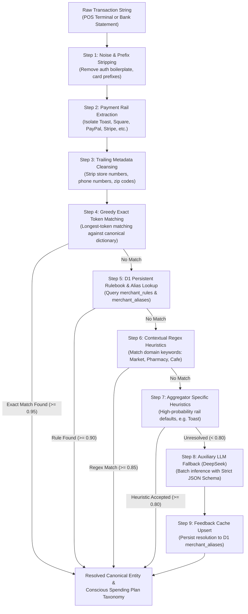

# SnapTally Merchant Normalization and Classification Architecture

This document specifies the deterministic pre-processing pipeline, payment rail extraction, exact dictionary matching, persistent database caching, and structured language model fallback contracts powering SnapTally's transaction normalization engine.

---

## 1. Architectural Philosophy and System Boundaries

Financial statement descriptors from credit cards and banks are noisy, inconsistent, and burdened with payment processor artifacts, terminal identifiers, and geographical metadata. 

SnapTally adopts a **strict waterfall resolution strategy**:
1. **Deterministic Edge First**: Strip transaction noise, extract payment rails, and evaluate canonical lookup tables entirely in deterministic code (TypeScript at the edge; Python in offline batch ETL pipelines).
2. **Persistent Dynamic Cache**: Check local SQLite/D1 tables (`merchant_aliases` and `merchant_rules`) before any external network invocation. Known merchants resolve in under 10ms with zero marginal token cost.
3. **Constrained Model Fallback**: Only route low-confidence, novel descriptors to an external language model (DeepSeek or Gemini) using strict JSON Schema Structured Outputs.
4. **Self-Reinforcing Feedback Loop**: Automatically persist high-confidence model inferences and manual user overrides into the local database so subsequent transactions from the same merchant resolve deterministically.



---

## 2. String Sanitization and Pre-Processing Pipeline

### 2.1 Step 1: Authorization Boilerplate and Prefix Removal
Bank descriptors frequently include leading authorization tags, transaction channels, or date prefixes. These are stripped prior to entity analysis:

```typescript
const NOISE_PREFIXES: RegExp[] = [
  /^(?:PURCHASE AUTHORIZED ON \d{2}\/\d{2}(?:\/\d{2,4})?\s*)/i,
  /^(?:CHECKCARD|PURCHASE|WITHDRAWAL|POS DEBIT|DEBIT CARD PURCHASE|RECURRING PAYMENT)(?:\s+\d{2}\/\d{2}(?:\/\d{2,4})?)?\s*-?\s*/i,
  /^\d{2}\/\d{2}(?:\/\d{2,4})?\s*/,
  /^(?:PAYMENT TO|DIRECT DEBIT|ACH DEBIT)\s*/i
];
```

### 2.2 Step 2: Payment Rail and Gateway Isolation
Intermediary payment gateways mask the true underlying merchant while embedding category signals. The pipeline captures the rail identifier for heuristic routing, then strips the gateway prefix:

| Payment Rail | Matching Regular Expression | Heuristic Signal |
| :--- | :--- | :--- |
| **Toast** | `^(?:TST\*\|TOAST\*\|TOAST POS\s*-\s*)` | Food & Beverage (>95% dining probability) |
| **Square** | `^(?:SQ\s*\*\|SQR\*\|SQUARE\s*\*\|SQC\*)` | Mixed retail, dining, services |
| **PayPal** | `^(?:PAYPAL\s*\*\|PP\*\s*)` | Online retail, digital subscriptions |
| **Stripe** | `^(?:STRIPE\*\|SP\*\s*)` | SaaS, e-commerce, digital products |
| **Shopify** | `^(?:SHOPIFY\*\|SP\s+)` | Direct-to-consumer e-commerce |
| **Venmo** | `^(?:VENMO\s*\*\|VENMO PAYMENT\s*)` | Peer-to-peer, informal dining splits |
| **Apple Pay** | `^(?:APL\*\|APPLE\.COM\/BILL\s*)` | Digital media, subscriptions, apps |

### 2.3 Step 3: Trailing Metadata and Geo Artifact Cleansing
Descriptors often append physical store identifiers, terminals, phone numbers, state abbreviations, and zip codes. These are excised to produce a clean alphanumeric search token:

```typescript
const TRAILING_NOISE_PATTERNS: RegExp[] = [
  /\b\d{3}[-.\s]\d{3}[-.\s]\d{4}\b/g,               // Telephone numbers: 800-555-0199
  /\bSTORE\s*#?\s*\d+\b/gi,                         // Store identifiers: STORE 0482
  /\bLOC(?:ATION)?\s*#?\s*\d+\b/gi,                 // Location identifiers: LOC 129
  /(?:^|\s)#\s*[\w\d-]+\b/g,                        // Store tags: #1024, #B-12
  /\bT-\d+\b/gi,                                    // Retail register formats: T-0921
  /\.COM(?:\/[A-Z0-9]+)?/gi,                        // Web domains: NETFLIX.COM
  /\s+\b[A-Z]{2}\s+\d{5}(?:-\d{4})?\b/gi,           // State + Zip code: MA 02138
  /\s+\b(?:CAMBRIDGE|BOSTON|SOMERVILLE|SEATTLE|SAN JOSE|NEW YORK|SAN FRANCISCO)\b(?=\s+[A-Z]{2}\b|\s*$)/gi, // Trailing city tokens
  /\s+\b[A-Z]{2}\b$/g,                              // Trailing state abbreviation: BOSTON MA
  /\s+\b\d{4,}\b$/g                                 // Trailing numeric sequences (>= 4 digits)
];
```

*Note on Number Preservation:* Standalone numeric removal is restricted to trailing positions (`\b\d{4,}\b$`) or anchored patterns (`STORE`, `#`) to protect legitimate merchant names containing numbers (e.g. 7-Eleven, Studio 54). Unanchored city name removal is strictly anchored to trailing positions or preceding state abbreviations to avoid truncating brands like Boston Market.

---

## 3. Taxonomy Mapping: Conscious Spending Plan

SnapTally normalizes all transactions directly into Ramit Sethi's **Conscious Spending Plan (CSP)** taxonomy, using the canonical bucket keys established in `src/config/intake.ts` and `docs/budgeting.md`:

```typescript
export interface NormalizedClassification {
  canonical_name: string;
  parent_bucket: "Fixed Costs" | "Investments" | "Savings" | "Guilt-Free";
  subcategory: string;
  reward_multiplier_category: "Dining" | "Groceries" | "Travel" | "Gas" | "Entertainment" | "Drugstores" | "Wholesale" | "Other";
}
```

### 3.1 Common Canonical Rules

| Normalized Keyword | Canonical Name | Parent Bucket | Subcategory | Reward Multiplier Category |
| :--- | :--- | :--- | :--- | :--- |
| `WHOLE FOODS` | Whole Foods Market | Fixed Costs | Groceries | Groceries |
| `WHOLEFDS` | Whole Foods Market | Fixed Costs | Groceries | Groceries |
| `TRADER JOE` | Trader Joe's | Fixed Costs | Groceries | Groceries |
| `TRDR JOE` | Trader Joe's | Fixed Costs | Groceries | Groceries |
| `COSTCO WHS` | Costco Wholesale | Fixed Costs | Groceries | Wholesale |
| `BOSTON MARKET` | Boston Market | Guilt-Free | Dining | Dining |
| `STARBUCKS` | Starbucks | Guilt-Free | Coffee & Snacks | Dining |
| `TATTE BAKERY` | Tatte Bakery & Cafe | Guilt-Free | Coffee & Snacks | Dining |
| `BLUE BOTTLE` | Blue Bottle Coffee | Guilt-Free | Coffee & Snacks | Dining |
| `BERRYLINE` | Berryline | Guilt-Free | Coffee & Snacks | Dining |
| `SWEETGREEN` | Sweetgreen | Guilt-Free | Takeout | Dining |
| `CHIPOTLE` | Chipotle Mexican Grill | Guilt-Free | Takeout | Dining |
| `SHAKE SHACK` | Shake Shack | Guilt-Free | Takeout | Dining |
| `NETFLIX` | Netflix | Fixed Costs | Subscriptions | Entertainment |
| `SPOTIFY` | Spotify | Fixed Costs | Subscriptions | Entertainment |
| `AMAZON PRIME` | Amazon Prime | Fixed Costs | Subscriptions | Other |
| `AMAZON` | Amazon | Guilt-Free | Shopping | Other |
| `AMZN MKTP` | Amazon Marketplace | Guilt-Free | Shopping | Other |
| `UBER TRIP` | Uber | Fixed Costs | Transit | Travel |
| `UBER EATS` | Uber Eats | Guilt-Free | Takeout | Dining |
| `DOORDASH` | DoorDash | Guilt-Free | Takeout | Dining |
| `CHEVRON` | Chevron | Fixed Costs | Transit | Gas |
| `DELTA AIR` | Delta Air Lines | Savings | Travel Fund | Travel |
| `CONEDISON` | ConEdison | Fixed Costs | Utilities | Other |

---

## 4. Greedy Longest-Token Matching

When evaluating candidate exact rules, iteration order matters. If a broad root like `AMAZON` is matched before `AMAZON PRIME`, subscriptions will be misclassified as general shopping.

The matcher sorts candidate rule tokens by character length in descending order before matching:

```typescript
function matchExactRules(cleaned: string, rules: Map<string, NormalizedClassification>): NormalizedClassification | null {
  const sortedTokens = Array.from(rules.keys()).sort((a, b) => b.length - a.length);

  for (const token of sortedTokens) {
    const pattern = new RegExp(`\\b${escapeRegExp(token)}\\b`, "i");
    if (pattern.test(cleaned)) {
      return rules.get(token)!;
    }
  }

  return null;
}
```

This guarantees that:
- `AMAZON PRIME` matches before `AMAZON`.
- `UBER EATS` matches before `UBER`.
- `WHOLE FOODS MARKET` matches before `WHOLE FOODS`.

---

## 5. Persistent Dynamic Cache (D1 SQLite)

To prevent redundant external LLM inference, resolutions are stored in a persistent SQLite table.

### 5.1 Schema Contract (`merchant_aliases` and `merchant_rules`)

```sql
CREATE TABLE IF NOT EXISTS merchant_aliases (
  id TEXT PRIMARY KEY,
  user_id TEXT NOT NULL REFERENCES users(id) ON DELETE CASCADE,
  normalized_key TEXT NOT NULL,
  canonical_name TEXT NOT NULL,
  parent_bucket TEXT NOT NULL,
  subcategory TEXT NOT NULL,
  default_card TEXT,
  reward_multiplier_category TEXT,
  source TEXT NOT NULL CHECK(source IN ('user_override', 'exact_rule', 'llm_inference')),
  created_at DATETIME DEFAULT CURRENT_TIMESTAMP,
  updated_at DATETIME DEFAULT CURRENT_TIMESTAMP
);

CREATE UNIQUE INDEX IF NOT EXISTS idx_merchant_aliases_key 
ON merchant_aliases(user_id, normalized_key);
```

### 5.2 Resolution Lifecycle
1. When a transaction is submitted or imported, the normalizer produces a normalized alphanumeric key (`toAlphanumericKey(cleaned)`).
2. The engine queries `merchant_aliases` for `(user_id, normalized_key)`.
3. If present, the stored classification and `reward_multiplier_category` are applied with `confidence = 0.99`.
4. If absent, the engine walks exact rules, regex heuristics, and aggregator defaults.
5. If an LLM call is required (confidence < 0.80), the successful response is immediately upserted into `merchant_aliases` (persisting `reward_multiplier_category` alongside bucket and subcategory) with `source = 'llm_inference'`.
6. If the user edits the category or card in the UI, an upsert is executed with `source = 'user_override'`.

---

## 6. Language Model Fallback Contract (Structured Outputs)

When a descriptor cannot be resolved via deterministic rules or local database lookups, it is dispatched to an external language model (DeepSeek `deepseek-chat` or Gemini Flash via OpenAI-compatible endpoint).

### 6.1 Input Payload Specification

```json
{
  "unresolved_transactions": [
    {
      "id": 0,
      "raw_description": "PURCHASE AUTHORIZED ON 10/12 SQ *THE CORNER HABERDASHERY CAMBRIDGE MA",
      "cleaned_description": "THE CORNER HABERDASHERY",
      "payment_rail": "Square"
    },
    {
      "id": 1,
      "raw_description": "APL* CLOUD STORAGE BILLING 866-712-7753 CA",
      "cleaned_description": "CLOUD STORAGE BILLING",
      "payment_rail": "ApplePay"
    }
  ]
}
```

### 6.2 Strict JSON Schema Output Specification

To ensure compatibility with DeepSeek and OpenAI strict Structured Outputs (`response_format: { type: "json_schema", json_schema: { strict: true } }`), the root is an object containing an `items` array with explicit property schemas:

```json
{
  "type": "object",
  "properties": {
    "items": {
      "type": "array",
      "items": {
        "type": "object",
        "properties": {
          "id": { "type": "integer" },
          "canonical_name": { "type": "string" },
          "parent_bucket": {
            "type": "string",
            "enum": ["Fixed Costs", "Investments", "Savings", "Guilt-Free"]
          },
          "subcategory": { "type": "string" },
          "reward_multiplier_category": {
            "type": "string",
            "enum": ["Dining", "Groceries", "Travel", "Gas", "Entertainment", "Drugstores", "Wholesale", "Other"]
          },
          "confidence": { "type": "number" },
          "reasoning": { "type": "string" }
        },
        "required": [
          "id",
          "canonical_name",
          "parent_bucket",
          "subcategory",
          "reward_multiplier_category",
          "confidence",
          "reasoning"
        ],
        "additionalProperties": false
      }
    }
  },
  "required": ["items"],
  "additionalProperties": false
}
```

---

## 7. Edge Runtime (TypeScript) vs Offline Batch ETL (Python)

SnapTally operates across two execution environments:

1. **Edge Runtime (Cloudflare Pages Functions / Workers)**:
   - Written in TypeScript.
   - Executes during point-of-sale intake (`POST /api/transactions`) and autocomplete (`GET /api/merchants`).
   - Latency target: < 15ms for Tier 1 through Tier 7.
   - Non-blocking fallback: if Tier 8 LLM call exceeds 2,500ms, transaction commits with an unclassified marker for deferred background resolution.

2. **Offline Batch ETL (Python / Task Runner)**:
   - Script `scripts/merchant_parser.py` used for historical CSV migrations, Google Sheets statement reconciliation, or bulk card exports.
   - Batches 20 to 50 unresolved lines into a single DeepSeek inference call.
   - Directly seeds the initial D1 `merchant_aliases` table.

---

## 8. Failure Modes and Mitigations

1. **Merchant Category Code (MCC) Asymmetry**:
   - Problem: Acquirer network MCC codes dictate rewards multipliers (e.g. MCC 5814 Fast Food vs 5411 Grocery), but consumer statement exports omit 4-digit MCCs.
   - Mitigation: Default to conservative baseline multipliers unless an unambiguous merchant rule is present in `src/config/rewards.ts`.
2. **Aggregator Over-Generalization**:
   - Problem: Square (`SQ*`) processes charges for dental clinics, barbers, and auto mechanics, not just coffee shops.
   - Mitigation: Never assign a default category purely based on Square or Stripe. Only Toast retains a high-confidence dining heuristic.
3. **External Model Outage or Latency**:
   - Problem: DeepSeek or Gemini API experiences an outage or elevated response latency.
   - Mitigation: The edge intake pipeline never fails a user transaction on LLM timeouts. It falls back to title-casing the cleaned string, assigning `parent_bucket = 'Guilt-Free'` and `subcategory = 'Dining'`, and queuing the transaction ID for background re-classification.
